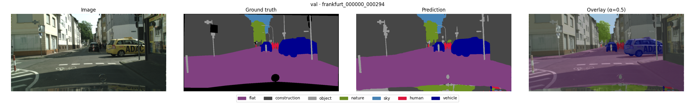
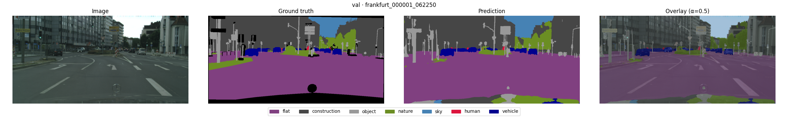
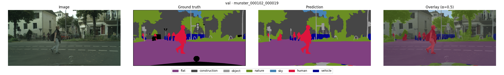

# Road Segmentation — Cityscapes

Semantic segmentation of urban driving scenes. UNet + EfficientNet-B4 encoder trained on [Cityscapes](https://www.cityscapes-dataset.com/) at 1024×512, predicting **7 Cityscapes categories** (flat · construction · object · nature · sky · human · vehicle): **0.886 mIoU** on the val split (3 cities never seen during training).

---

## Demo

<table>
  <tr>
    <td></td>
  </tr>
  <tr>
    <td></td>
  </tr>
</table>

*Left: original frame — Right: segmentation overlay. Stuttgart is one of the training cities (the demo frames themselves are not in the training set).*

---

## Results

<!--
  Regenerate this section from results/metrics.json, produced by:
    python scripts/evaluate.py --checkpoint best.pth --data_root /path/to/preprocessed \
        --examples_dir assets/examples
  The script prints the Markdown tables below.
-->

| Class | IoU |
|---|---|
| flat | 0.985 |
| construction | 0.921 |
| object | 0.697 |
| nature | 0.920 |
| sky | 0.943 |
| human | 0.811 |
| vehicle | 0.927 |
| **mean** | **0.886** |

| Val city | Images | mIoU |
|---|---|---|
| Frankfurt | 267 | 0.881 |
| Lindau | 59 | 0.879 |
| Münster | 174 | 0.894 |

The score holds across the three cities (spread of 1.5 points).

Pixel accuracy 0.970 · 500 val images · EfficientNet-B4 · 1024×512 · trained 50 epochs, checkpoint from epoch 49 (best val score) · Colab L4, batch size 2 · raw output in [`results/metrics.json`](results/metrics.json)

### How the metric is computed

- **Dataset-level mIoU**: one confusion matrix is accumulated over all 500 val images, then IoU = TP / (TP + FP + FN) per class, averaged over the 7 categories (`src/metrics.py`).
- Pixels labelled *void* in the ground truth (ego vehicle, rectification border, …) are ignored.
- **Not the official category benchmark protocol**: the official evaluation runs at full resolution (2048×1024) and ignores 8 rare classes (parking, rail track, guard rail, bridge, tunnel, pole group, caravan, trailer), whereas here they are merged into their category (`scripts/preprocess.py`).
- Per-epoch training log: [`results/training_log.csv`](results/training_log.csv). Its `val_miou_batch_avg` column comes from an earlier version of the metric (mean of per-batch mIoUs, 0.842 at epoch 49), which underweights rare classes; re-evaluated with the dataset-level metric above, the same checkpoint scores 0.886.

---

## Examples

Evenly spaced images from the val set, generated by `scripts/evaluate.py --examples_dir assets/examples`.





---

## Quick Start

```bash
pip install -r requirements.txt
```

**1. Preprocess** *(run once locally)*
```bash
python scripts/preprocess.py \
  --data_root /path/to/cityscapes \
  --output_dir /path/to/preprocessed \
  --width 1024 --height 512
```

**2. Train** *(Colab)*

Upload the zipped preprocessed data to Drive, open [`notebooks/train_colab.ipynb`](notebooks/train_colab.ipynb), set `RUN_NAME`, run all cells. Each run writes `best.pth`, `last.pth`, `history.csv` (per-epoch losses and IoUs) and `metrics.json` to its own Drive folder.

**3. Evaluate**
```bash
python scripts/evaluate.py \
  --checkpoint path/to/best.pth \
  --data_root  path/to/preprocessed
```
Prints per-class and per-city IoU and writes `results/metrics.json`. Add `--examples_dir assets/examples` to also save example figures.

**4. Inference on video**
```bash
python scripts/infer_video.py \
  --checkpoint path/to/best.pth \
  --frames_dir path/to/frames/ \
  --output     path/to/output.mp4
```
---

## Architecture

| | |
|---|---|
| Model | UNet |
| Encoder | EfficientNet-B4 (ImageNet pretrained) |
| Loss | 0.5 × CrossEntropy (object & human weighted ×3) + 0.5 × Dice |
| Optimizer | AdamW + cosine schedule with 5-epoch warmup |
| Input | 1024×512 |
| Outputs | 8 channels: the 7 categories + an unused *void* channel (void pixels are ignored in the loss and metric) |

---

## Class Palette

<table>
  <tr>
    <td align="center"> flat</td>
    <td align="center"> construction</td>
    <td align="center"> object</td>
    <td align="center"> nature</td>
    <td align="center"> sky</td>
    <td align="center"> human</td>
    <td align="center"> vehicle</td>
  </tr>
</table>
